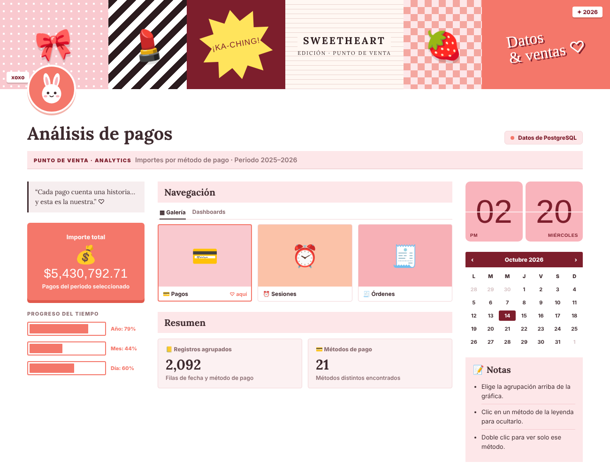
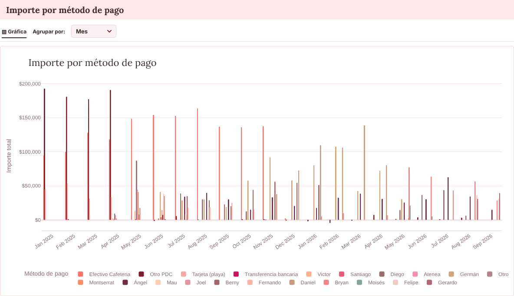
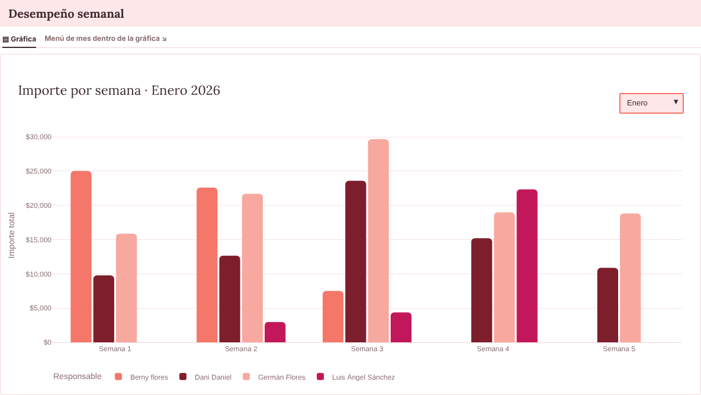
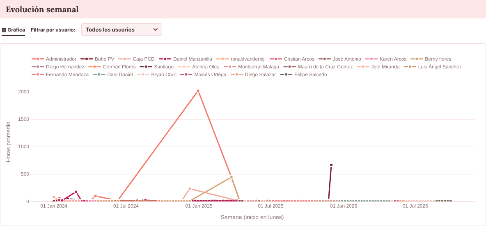
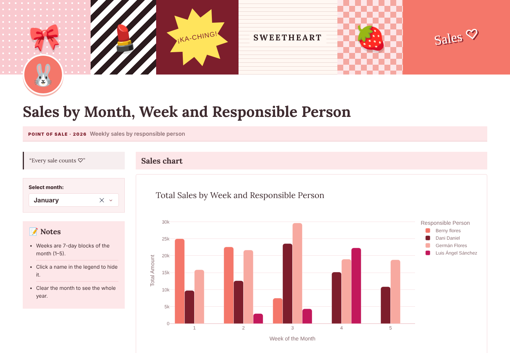
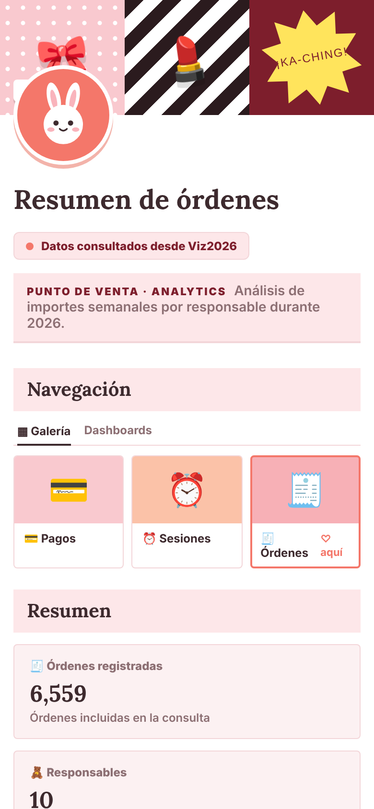
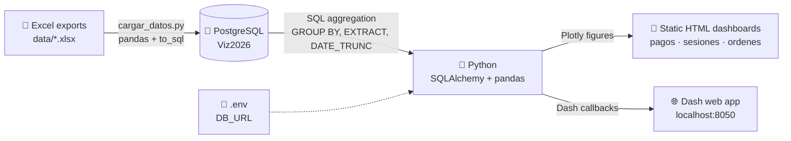

<div align="center">

# 🎀 Viz2026 · Point-of-Sale Analytics Dashboard

**From raw POS exports to an interactive, scrapbook-style analytics dashboard.**
PostgreSQL · SQL · Python · Plotly · Dash




</div>

---

## ✨ Overview

This project turns four Excel exports from a point-of-sale system (**~86,000 rows** of orders, payments and cash-register sessions) into a set of interactive dashboards that answer three business questions:

| Dashboard | Question it answers | Source table |
|---|---|---|
| 💳 **Payments** | How much money comes in through each payment method, by day, week, month or quarter? | `pagos_punto_venta` |
| ⏰ **Sessions** | How long do cash-register sessions last, and how does that change week to week per employee? | `sesion_punto_venta` |
| 🧾 **Orders** | How much does each person sell, week by week, during 2026? | `ordenes_punto_venta` |
| 📊 **Dash app** | A live web app (Flask/Dash server) to explore weekly sales by month. | `ordenes_punto_venta` |

All aggregation is done **in SQL inside PostgreSQL**; Python only shapes the results and renders them.

---

## 🔎 Key insights from the data

| | Insight |
|---|---|
| 💰 | **$5.43M** in payments across **21 payment methods** (2025–2026). Cash at the cafeteria alone accounts for **27%** ($1.47M). |
| 🧾 | **6,559 orders** worth **$1.67M** in 2026 so far. The top seller handled **28%** of revenue across 1,770 orders. |
| ⏱️ | A typical session lasts **~7.4 hours** (median), yet **29 of 3,038** sessions stayed open for more than 24 h. |
| 🚨 | One session was left open for **84 days** (Jan 1 → Mar 26, 2025) and later needed a *"rescue"* session. That kind of data-quality issue shows up as the big spike in the sessions chart, so it's easy to spot. |

---

## 🖼️ Screenshots

<table>
<tr>
<td width="50%"><br><sub><b>Payments</b> · regroup by day / week / month / quarter on the fly</sub></td>
<td width="50%"><br><sub><b>Orders</b> · weekly revenue per person, month selector</sub></td>
</tr>
<tr>
<td width="50%"><br><sub><b>Sessions</b> · weekly average duration, filter by employee</sub></td>
<td width="50%"><br><sub><b>Dash app</b> · server-side callbacks</sub></td>
</tr>
</table>

<p align="center"><br><sub>Fully responsive: the 3-column layout stacks on phones</sub></p>

---

## 🏗️ Architecture



**Design choices**

- **Push work to the database.** Weekly buckets, date filters and totals are computed in SQL (`EXTRACT`, `DATE_TRUNC`, `FLOOR`, `COALESCE/NULLIF` for missing values), so Python receives small, already-aggregated tables.
- **Self-contained HTML reports.** The three dashboards embed Plotly and their data in a single file, so they open offline with a double click and can be shared without a server. Filters (period grouping, employee) run client-side in JavaScript.
- **A real web app too.** `app.py` shows the same idea as a Dash app with server-side callbacks.
- **No secrets in the repo.** The connection string lives in a git-ignored `.env` file and is loaded with `python-dotenv`. `.env.example` shows the expected format.
- **Defensive cleaning.** Payment dates arrive as text mixed with subtotal rows, so a regex filter (`~ '^[0-9]{4}-...'`) keeps only valid timestamps. Sessions without a closing time or with negative durations are excluded.

---

## 🎨 UI / UX

- Notion-inspired **scrapbook layout**: collage cover, avatar, serif headings and a coral · blush · wine palette.
- **Three-column page**: main KPI and time-progress bars · gallery navigation and summary · live clock, calendar and how-to notes. The chart gets its own full-width section below.
- Custom **23-color categorical palette** applied consistently to all charts, rounded bar corners and on-brand tooltips.
- Gallery cards link the three dashboards together like a small website.
- Responsive down to **390 px** with no horizontal scrolling.

---

## 🚀 Getting started

**Requirements:** Python 3.10+ and PostgreSQL.

```bash
# 1. Clone and enter the project
git clone https://github.com/BialexAcosta/dashboard-viz2026.git
cd dashboard-viz2026

# 2. Create a virtual environment and install dependencies
python -m venv .venv
source .venv/Scripts/activate        # Windows (Git Bash)  ·  macOS/Linux: source .venv/bin/activate
pip install -r requirements.txt

# 3. Create an empty database called Viz2026 (pgAdmin or psql), then set your connection
cp .env.example .env                  # edit .env with your PostgreSQL password

# 4. Load the Excel files into PostgreSQL (run once)
python cargar_datos.py

# 5. Build the dashboards
python pagos.py && python sesiones.py && python ordenes.py

# 6. (Optional) run the Dash app → http://127.0.0.1:8050
python app.py
```

> 🇲🇽 Step-by-step setup in Spanish: see [`LEEME.md`](LEEME.md).
> Just want a look? Open the files in [`vista_previa/`](vista_previa/) in your browser.

---

## 📁 Project structure

```
├── app.py              # Dash web app (server + callbacks)
├── pagos.py            # Payments dashboard  → pagos.html
├── sesiones.py         # Sessions dashboard  → sesiones.html
├── ordenes.py          # Orders dashboard    → ordenes.html
├── cargar_datos.py     # Loads data/*.xlsx into PostgreSQL
├── assets/kawaii.css   # Styles for the Dash app (auto-loaded by Dash)
├── data/               # Raw POS exports (.xlsx)
├── vista_previa/       # Pre-built HTML dashboards
├── docs/screenshots/   # Images used in this README
├── .env.example        # Connection-string template (real .env is git-ignored)
├── requirements.txt
└── LEEME.md            # Setup guide in Spanish
```

---

## 🧠 What I practiced

- Modeling and loading raw business exports into a relational database
- Writing aggregation queries with date functions, conditional cleaning and grouping
- Connecting Python to PostgreSQL with SQLAlchemy and keeping credentials out of version control
- Building interactive visualizations with Plotly, both as static reports and as a Dash app
- Designing a dashboard layout that is readable, responsive and has a clear visual identity
- Spotting data-quality issues, like sessions that were never closed, through visualization

---

<div align="center">

Made with 💖 by **[Bianca Acosta Castellanos](https://github.com/BialexAcosta)**, Data Engineering student

</div>
